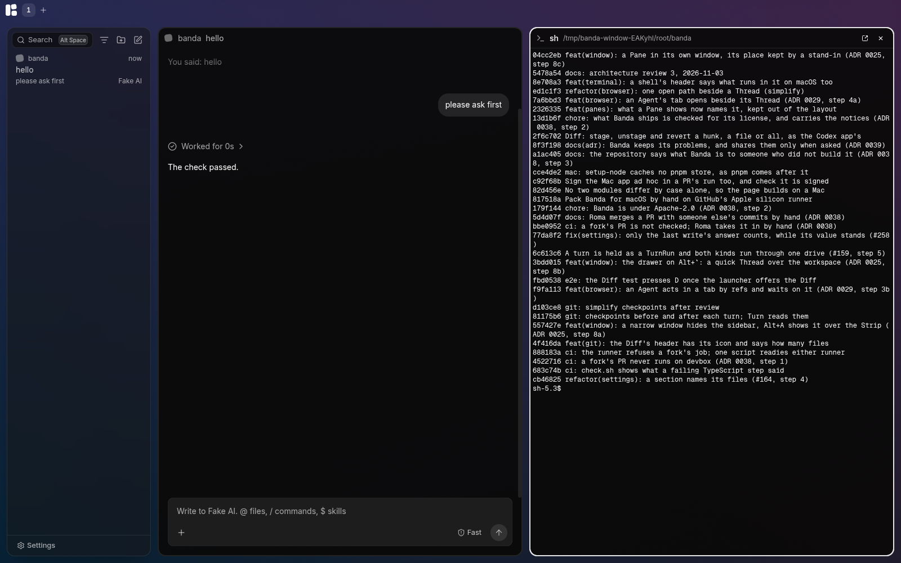

# Banda

A tiling workspace for working with Agents: a desktop app first, then your own
server or our cloud, then teams.



Each project is a Space. In it, Panes sit side by side in columns you scroll
through: Threads where you work with an Agent (Claude Code or Codex), the
terminal, a browser, the Diff of what changed. You work with Agents you
already have, in the folders you already have.

Banda runs on Linux (x64) and macOS (Apple silicon). Only Banda Dev is
published for now; a Stable release will come later.

## Install it

### macOS

Install [Homebrew](https://brew.sh), then Banda Dev from our tap:

```sh
brew install --cask 0x1oceanlabs/banda/banda-dev
```

Open **Banda Dev** from Applications. The app is signed ad hoc and is not
notarized yet; the cask removes its quarantine so macOS lets it open.

### Linux

Download the newest `banda-dev-…-x86_64.AppImage` from
[Releases](https://github.com/0x1oceanlabs/banda/releases), make that file
executable, and start it from the folder containing the download:

```sh
chmod +x ./banda-dev-*-x86_64.AppImage
./banda-dev-*-x86_64.AppImage
```

It needs FUSE 3 and adds itself to your launcher on its first start.

## Updates

Banda Dev is published after a green push to `main`. Its widget on the bar
shows the running version and checks for a new one a minute after launch,
then every hour. The Banda menu's **Check for updates** checks at once.

- **Linux AppImage:** downloads a new version in the background and
  installs it when you quit. **Update now** in the widget downloads and
  restarts at once; the popover warns that a restart stops active turns.
- **macOS:** tells you when a new version is out and offers a command to
  copy. Homebrew installs it:

  ```sh
  brew update && brew upgrade --cask banda-dev
  ```

  Quit Banda Dev before upgrading, then open it again. If the Mac's files
  are still being published, Banda checks again in a minute.

Banda Dev keeps its data and settings apart from the future Stable app
and from Banda Local, which runs from a checkout.

## What it needs

- **A Harness**: Claude Code (`claude`) or Codex (`codex`), installed and
  signed in, and recent: Banda says so if it is too old. It runs as it
  would in your terminal, so its account, its plan and its settings are
  yours.

Nothing else: Banda carries the Agent Client Protocol adapter it talks to
each Harness through, and runs it on its own Node.

## What it sends

Nothing of its own unless you turn it on. There is no account, and a
crash is kept on your machine. At the first run Banda asks whether to
send problem reports and usage counts, both unticked; Settings → Sharing
changes it, and shows each event exactly as it went. They go to PostHog
(US) with a random ID, no IP and no location, and only from a released
Banda: the code that sends is `modules/sharing`, and nothing else does.
Your Agents talk to their providers as they do in a terminal, and the
browser loads the pages you or your Agents open.

## Build it

How it is built: [`docs/architecture.md`](docs/architecture.md), the
decisions in [`docs/adr/`](docs/adr/), the words in
[`GLOSSARY.md`](GLOSSARY.md). How to help: [`CONTRIBUTING.md`](CONTRIBUTING.md).

### Run it from a checkout

You need Rust (stable), Node 24 and pnpm 11.

```sh
pnpm install
cargo build                              # the engine and the fake agent
pnpm --filter @banda/desktop start     # builds the page and opens the window
```

A build from a checkout is Banda Local: it keeps its things in folders of
its own (`~/.config/banda-local`, `~/.local/share/banda-local`,
`~/.local/state/banda-local`) and its window's class is `banda-local`, so
it runs beside an installed Banda without touching its Spaces (ADR 0033).
`BANDA_CHANNEL=stable` or `dev`, set for `cargo build` and the window's
build alike, makes it Banda or Banda Dev instead.

Without `~/.config/banda-local/harnesses.toml` the engine offers Claude Code
and Codex. To try the window without a paid model, list the fake agent
there instead:

```toml
[[harness]]
id = "fake"
name = "Fake AI"
command = "/path/to/banda/target/debug/banda-fake-agent"
```

For the page with live reload, run `pnpm --filter @banda/web dev` and,
beside it, `pnpm --filter @banda/desktop dev`.

### Try a branch

```sh
scripts/try.sh                   # this checkout or worktree
scripts/try.sh agents-turn-run   # a worktree's slug in ../banda-worktrees
```

It builds the tree and opens a Banda Local window from it, with a trial
of its own in `~/.local/state/banda-trial/<slug>`: its Spaces and
settings never touch the Banda you work in, and trials of several
branches run at once. The fake agent is its Harness, so a trial costs no
tokens; `--real` offers Claude Code and Codex instead, `--fresh` forgets
the trial's Spaces, `--no-build` starts what was built last, `--list` and
`--forget` look after the trials. Set `CARGO_TARGET_DIR` to one folder
for every tree and only Banda's own crates build again.

A trial's window serves CDP, and `scripts/drive.mjs` drives it: takes its
picture, reads what it shows, clicks, types and presses keys. That is how
an Agent tries what it changed ([`AGENTS.md`](AGENTS.md), "See what you
changed").

### Pack it

```sh
scripts/package.sh dev    # or local
```

It builds the engine for release, the page and the window, and packs an
AppImage on Linux or an Apple silicon app in a zip on macOS, under
`app/desktop/dist/` (ADR 0033). `BANDA_VERSION` names its version; unset,
it is the workspace's version, marked local. The release workflow packs
and publishes Dev on a green push to `main`
([`.github/workflows/release.yml`](.github/workflows/release.yml)).

The ways to bring Banda to Linux: [`docs/research/2026-11-02-linux-distribution.md`](docs/research/2026-11-02-linux-distribution.md).

### Check it

```sh
scripts/check.sh               # everything: Rust, types, lints, tests, the window
scripts/check.sh --no-window   # without the window's end-to-end tests
```

## License

Banda is under the [Apache License 2.0](LICENSE). It includes code from T3
Code, Ghostty and the Nerd Fonts under their MIT licenses; [`NOTICE`](NOTICE)
says which and where.
