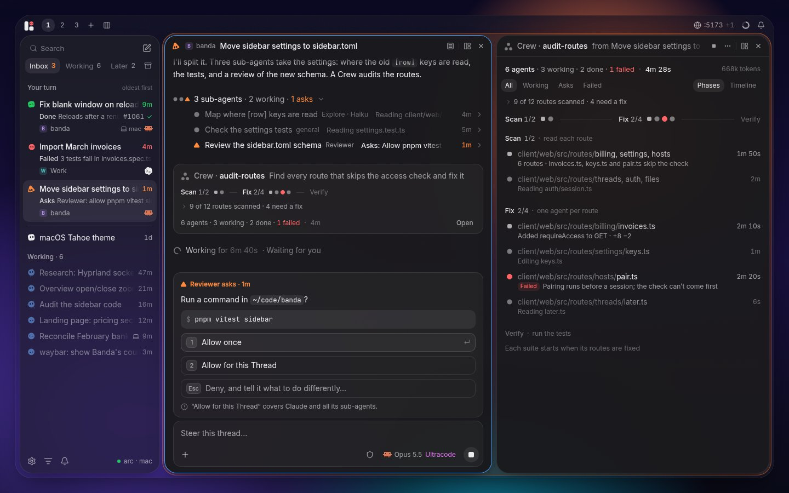
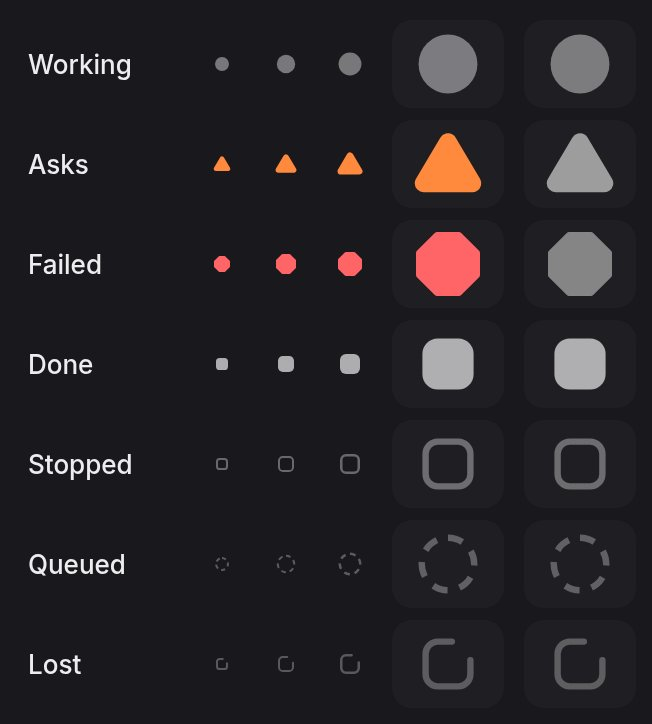
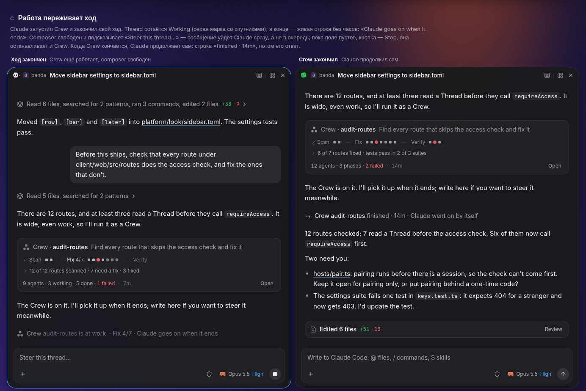

# A Harness's sub-agents work in their Thread, and a Crew shows beside it

_It amends ADR 0003 (its "Later" and decision 6's idle release), ADR 0031
(Ultracode in the model picker), ADR 0058 (decisions 4–6 and 8), ADR 0089
(decision 8, the phone) and ADR 0099 (decisions 2, 3 and 11), and gives
ADR 0098, decision 24, its field. The look is the
design reference's, [`docs/design/README.md`](../design/README.md). Code is
cited from main at `bec527a3`; the research read `26feb9be`._

Roma, on 2026-11-10 (translated), over the mocks: "First, very good work
on the design of the windows and how Banda looks overall — let's describe
this visual style and save it as a reference. I really liked how we
designed the windows and the other elements. You did very good work; I
propose we simply follow all your recommendations." The visual style is
the design reference, in a PR of its own. This ADR takes the
recommendations for sub-agents and Crews.

The evidence is in
[`docs/research/2026-11-10-sub-agents/`](../research/2026-11-10-sub-agents/README.md):
how Claude Code and Codex run and show their sub-agents
(`claude-code.md`, `codex.md`), how other products do it
(`landscape.md`), how it fits Banda (`banda-arch.md`, §3–4) and what was
missing before the mocks (`gaps.md`). The mocks follow one brief and one
scenario, a Thread "Move sidebar settings to sidebar.toml" with three
sub-agents and the Crew `audit-routes`:

- [`00-hero.html`](../research/2026-11-10-sub-agents/mocks/00-hero.html):
  the whole window, the satellite's grammar, the ten questions;
- [`01-thread.html`](../research/2026-11-10-sub-agents/mocks/01-thread.html):
  sub-agents in the Thread;
- [`02-crew-in-thread.html`](../research/2026-11-10-sub-agents/mocks/02-crew-in-thread.html):
  a Crew in the Thread, its start, the composer;
- [`03-crew-pane.html`](../research/2026-11-10-sub-agents/mocks/03-crew-pane.html):
  the Crew Pane;
- [`04-subagent-pane.html`](../research/2026-11-10-sub-agents/mocks/04-subagent-pane.html):
  a sub-agent opened beside;
- [`05-sidebar.html`](../research/2026-11-10-sub-agents/mocks/05-sidebar.html):
  the sidebar, the Mark, the bar and notifications.

## Where it stands

- **Banda declares no sub-agents.** `shows()`
  (`apps/agents/engine/src/acp.rs:356-370`) declares forms, notices,
  boolean options and the terminal's output; no
  `clientCapabilities.subagents`. The crate has the types only behind
  `unstable_subagents`, and `Cargo.toml:13` turns on only
  `unstable_session_fork`. So both adapters fall back to their old form.
- **Claude's sub-agents flatten into the parent's work.** An Agent call
  comes as a `think` call titled with the task, drawn with the brain
  (`apps/agents/pane/src/entries/parts/ToolCall.tsx:200`). Every call the
  child makes comes on the parent's session with
  `_meta.claudeCode.parentToolUseId`, which `acp/said.rs` drops, so the
  work line counts it as the parent's (`did`,
  `apps/agents/pane/src/thread/timeline.ts:296`). The child's streamed
  text may open replies written as the parent's, since a new message id
  opens a new entry (`transcript.rs:600-609`): _inferred_, no recording
  shows it.
- **Codex shows a `spawnAgent` row**, a wrench with the tool's name
  (`ToolCall.tsx:202`), and none of the child's work. A child's approval
  comes as the parent's own Question, with no sign of who asks.
- **A Claude workflow is invisible until it ends.** The Workflow call is
  a "Workflow" row that ends at once. The turn ends, the Mark shows Done
  while up to 16 agents work, and nothing shows until "‹Agent› went on by
  itself." (`apps/agents/engine/src/between.rs:183`). The composer
  already offers Ultracode, in the mode menu with the Harness's other
  options (`apps/agents/pane/src/composer/picker.ts:1-4`,
  `picker.test.ts:40`), so a Person can start one today.
- **The effort has no colour.** The model picker draws it lighter, in
  words (`apps/agents/pane/src/composer/ModelPicker.tsx:94`; ADR 0058,
  decisions 1 and 8). ADR 0031's magenta for the top level is not drawn,
  and no token holds it.
- **A child's Question would be refused.** `Routes::of`
  (`acp/routes.rs:29`) knows only the Thread's own sessions, so a
  permission request from a child session is answered `Cancelled`
  (`acp.rs:255-259`), and a form too (`acp.rs:297`).
- **A long workflow can lose its process.** A Harness's process is let go
  after 30 minutes with no turn
  (`platform/harnesses/engine/src/hosts.rs:31`), and nothing keeps it
  while a workflow runs between turns.
- **Nothing counts sub-agents.** ADR 0099, decision 11, names a
  `ListedThread.subagents` that is not there yet (`ListedThread` is at
  `apps/agents/engine/src/model.rs:793`), and nothing could fill it.
- **The words are taken.** GLOSSARY's Workflow is ADR 0082's steps
  across Apps, and Task is reserved as `task@1`.

## Decision

### The words

1. **A sub-agent is a Harness's helper inside its Thread**: Claude
   Code's Agent and Task tools, Codex's `spawn_agent`.
   - It is part of its Thread's Agent, with no name, settings or pass of
     its own: ADR 0006 holds, one Agent per Thread. Its label is the
     Harness's ("Reviewer", "Explore").
   - What it asks of Banda runs under its Thread's pass, through the same
     session: a Visual it shows lands in the Thread, and a Pane it opens
     joins the Thread's Group (ADR 0065, decision 7).
   - On screen: "sub-agent", "sub-agents". Never "subagent" or "task".
2. **A Crew is the sub-agents one Thread set to work together in
   phases.** It is what Claude Code calls a workflow; Ultracode makes
   Claude start one for every big task. Workflow and Task keep their
   meaning. The Harness's own name for it is the Crew's title: "Crew ·
   audit-routes". A **phase** is one step of a Crew, as its script names
   it: "Scan", "Fix", "Verify". (Roma's call 1.)
3. **The states are Banda's words**: Working, Asks, Done, Failed,
   Stopped, Queued (a Crew's agent waits for a slot) and Lost (stopped
   when Banda restarted), with "attempt 2" and "from last run" after
   them. The parent is named by its Harness: "Claude", "Codex".

### Where a sub-agent is kept

4. **A sub-agent is a lane of its Thread**: a record and its own slice of
   the Thread's Body, kept by the Thread's host and read when it is
   opened (`banda-arch.md`, option B).
   - Not an entry in the parent's Body: every reader of a Thread's
     entries would have to learn to skip it, and a Crew is thousands.
   - Not a Thread of its own: a Thread takes messages and has turns, a
     queue, settings, Later and Archive. A sub-agent has none of them,
     and lives and ends in its parent's session.
   - Banda's `SubagentId` is its identity; the Harness's child session is
     evidence (ADR 0002, decision 7). A child the Harness resumes
     (Claude's SendMessage) goes on in the same lane.
5. **A Thread another Agent started through Banda stays a Thread**
   (ADR 0019): a child with ↳ under its parent (ADR 0098, decision 24).
   `ListedThread.parent` names the Thread whose Agent started it, the
   field decision 24 needs.
6. **Data first, then the client core, then the views.** The engine keeps
   lanes and Crews and says them as facts. Pure `thread/subagents.ts` and
   `crew.ts` in the Threads App place and word them, the same for every
   client (ADR 0089, decision 1). The views read those.

### What the engine does

7. **It declares sub-agents and routes a child before anything else.**
   - `unstable_subagents` in `Cargo.toml`, `subagents: {}` in `shows()`.
   - A `subagent_update` maps the child's session to its Thread before
     any of the child's traffic, so its Question and its forms reach the
     Thread and are not cancelled.
   - A replayed child is matched by its session and not written twice.
8. **It keeps lanes and says what they do.**
   - A table, `agents_subagents`, holds a lane: its Thread and turn, its
     parent lane, its Crew and phase; its title, role and model; its
     state, why it ended, whether it can be stopped, whether it runs in
     the background; when it started and ended; its prompt and report;
     how many calls it made and how many failed; the Harness's child
     session.
   - A lane's entries are kept as the Thread's are, in `agents_items`
     with a `sub` column. `agents.thread` leaves them out;
     `agents.subagent` answers them.
   - Facts: `subagent.started`, `subagent.changed`, at most once a second
     (ADR 0099, decision 11), and `subagent.ended`; `crew.started`,
     `crew.progressed` and `crew.ended`.
   - What a lane says between turns updates the lane. It never opens a
     turn of the Agent's own (`between.rs`).
9. **Crews come from Claude's raw SDK frames.**
   - The engine asks for them with `_meta.claudeCode.emitRawSDKMessages`
     on `session/new` and `session/load`, and reads them as
     `_claude/sdkMessage`: `task_started`, `task_progress` with its
     `workflow_progress` (phases; agents with their state, model,
     attempt, tokens, calls, times, prompt and result), `task_updated`,
     `task_notification` and `background_tasks_changed`.
   - The Workflow call's input gives the script's `meta` (name,
     description, phases) before any progress comes.
   - `workflow_progress` is not documented. It is read tolerantly: a
     frame Banda cannot read leaves the Crew as it was.
10. **The contract, in short** (Rust in `model.rs`, TypeScript
    generated):
    - `Subagent`: id, turn, parent, crew, phase, title, role, model,
      state, why, can_stop, background, started, ended, prompt, report,
      calls, failed, doing. `SubagentState`: Running, Asks, Done,
      Stopped, Failed, Queued and Lost, said in decision 3's words; the
      RFD's `unknown` is Lost.
    - `Crew`: id, turn, title, description, phases, agents, state,
      started, ended, tokens. `Phase`: index, title. `CrewAgent`: index,
      label, phase, state, model, attempt, tokens, calls, took, prompt,
      result, lane.
    - `Body` gains two anchors, `subagent` and `crew`. `ThreadView` gains
      `subagents` and `crews`. `Question` gains `sub`, who asks, and a
      list's `Asking` the asker's label, for the card's line 2.
    - `ListedThread` gains `subagents` (the direct ones that work or
      ask), `failed` (those that failed while the Thread works), `crew`
      (title, phase, phases, working, done) and `parent`.
    - Methods: `agents.subagent` and `agents.crew` (Read),
      `agents.stop_subagent` (Write).
11. **A Harness's process with sub-agents at work is not idle.**
    `Connection::idle_since` is none while a lane works or asks, or while
    `background_tasks_changed` says background work goes on. The
    30-minute release (ADR 0003, decision 6) waits for it.

### The satellite

12. **One small unit stands for a sub-agent everywhere: the satellite,
    whose shape is its state.** (Roma's call 2.)
    - It is the Mark's grammar with no eyes and no motion of its own: a
      square is calm, a circle works, a triangle needs the Person, an
      octagon failed. It is not a mark, as a sub-agent has none (ADR
      0099, decision 3, holds).

      | State | Shape | Colour |
      |---|---|---|
      | Working | circle | the text at 45% |
      | Asks | triangle | `--attention` |
      | Failed | octagon | `--destructive` |
      | Done | square | the text at 70%; green is the Thread's |
      | Stopped | square, outlined | the text at 38% |
      | Queued | circle, dashed | the text at 32%; Crews only |
      | Lost | square, faint, with a gap | the text at 30% |

    - 8 px in a Crew's strip, 10 px at a row's start, 12 px in a Pane's
      header and its status bar, as the design reference's kit has them.
      The shapes read in greyscale.
    - A change of state blends in 0.45 s, a change of shape leaps in
      0.6 s, as the Mark's do (ADR 0099, decision 4).
    - It is the Mark's orbit, a row's glyph, a dot of a Crew's strip and
      the icon of a sub-agent's Pane.
13. **On the Mark, only a failed sub-agent takes colour**: a red octagon
    at 48 px, a red dot at 16 px, while its Thread works. At 16 px the
    dot is 3 px and is not dimmed with its row. The rest stay grey, as
    ADR 0099 has them, circles at 48 px. No orange satellite: a sub-agent
    that asks makes the Thread itself ask. (Roma's call 4.)

### Where it shows, by how much there is

14. **The surface scales with the work.**

    | How many | In the Thread | Beside it |
    |---|---|---|
    | One sub-agent | a row where it started | its Pane, on demand |
    | 2–6 from one message | a group row, its members under it | the same |
    | A Crew, of any size | a Crew card | the Crew Pane, in the Thread's Group |

    Never a wall of nested logs in the parent, a card per sub-agent in
    the sidebar (ADR 0098, decision 23), or a parent that looks done
    while its sub-agents work.
15. **A sub-agent's row** has the work line's left edge: the satellite,
    the title, the role and the model when it differs from the parent's
    ("Explore · Haiku"), what it does now or how it ended, and its time.
    - Working is grey and says what it does ("Reading auth.ts"); Asks
      takes colour on its triangle and time only; Done shows its
      report's first line and its duration; Failed, why; Stopped, "Stopped
      by you" when the Person did.
    - A click opens it in place, with nothing above it moving: the brief
      (two lines, more), its work as one work line, its report as quoted
      prose that fades when long, and Open beside and Stop while they
      apply. The pointer shows them at the row's right instead of the
      time.
    - A group row says "3 sub-agents · 2 working · 1 asks"; once all are
      done it folds into one line, "Ran 3 sub-agents · 2m 40s", at 55%,
      and opens on a click.
16. **The Thread shows one level.** A sub-agent's own sub-agents are
    "(+2)" on its row; its Pane goes deeper (decision 21).
17. **A Codex sub-agent without a name** is named by its number among its
    siblings and its prompt's first words, faded: "Agent 2 · Map the
    auth…". Codex has no Crews.
18. **A Crew's card is the one thing a Crew puts in the Thread**, where
    Claude started it.
    - Its head: three satellites, "Crew · audit-routes" and its
      description. Its strip: each phase's name and its agents' dots,
      the current phase bright, past ones with ✓, future ones faint; a
      phase of more than 24 dots becomes a thin bar of shares and its
      count, so the strip stays one line at 500 agents. Under it, one
      quiet line of what the script last logged. Its foot: "12 agents · 6
      working · 4 done · 2 failed", the failed number alone in red, the
      time, and Open (`Enter`).
    - A dot's tooltip names its agent and its state; a click opens it in
      the Crew Pane.
    - Finished: "12 agents · 3 phases · 2 failed · 14m". Lost: "Stopped
      when Banda restarted · 7 of 12 done" and Ask Claude to go on
      (decision 26). After a relaunch, the dots from the last run are
      dimmer.
19. **The live line names them** (ADR 0058, decision 5): "Working for
    45s · 3 sub-agents at work", "· Waiting on Explore", "· Crew
    audit-routes · Fix 4/7".
    - **Work that outlives the turn keeps the Thread Working**, its mark
      grey with satellites, and its live line at the Thread's end, with
      no clock: "Crew audit-routes is at work · Fix 4/7 · Claude goes on
      when it ends", or "Reviewer is at work · Claude goes on when it
      ends". The composer is free and steers.
    - When it ends, a line "↩ Crew audit-routes finished · 14m · Claude
      went on by itself", then Claude's reply. A background sub-agent
      ends the same way: "↩ Reviewer finished".
20. **One clock ticks per surface**: the live line, and the Crew Pane's
    header. Rows show a duration that does not tick. **Tokens show only
    in the Crew Pane and an agent's detail.** (Roma's calls 5 and 6.)

### Beside the Thread

21. **A sub-agent opens beside as a Pane, `agents.subagent`**, in the
    Thread's Group (ADR 0065, decision 7): the Thread's view, read only.
    - Its header: its satellite, its name and "sub-agent of ‹Thread›"; a
      breadcrumb when it is deeper, "Move sidebar settings › Reviewer ›
      Explore". A click on a crumb or `Esc` goes one level up.
    - Its brief is the parent's bubble, "Claude asked" ("Reviewer asked"
      for a nested one); a later message from Claude, "Claude wrote".
      Then its work and replies, as any Thread's.
    - The composer's place holds a status bar of the composer's shape,
      with no text box: "Working · Explore · Haiku · Runs on its own",
      Ask Claude about it, and Stop while it can.
    - A Group holds one sub-agent Pane: Open beside on another changes
      what it shows, and its row stays lit while it shows it. Its own
      sub-agents are rows in it, one level, and open in the same Pane.
    - Where there is no room for a Group (a narrow window, the Drawer, a
      phone), it is a screen on top, with a way back; a nested one is
      one more screen, in place of the breadcrumb. On a phone it goes on
      the stack as a Thread's screen does, since it is its Thread's view:
      ADR 0089, decision 8, would only name it and open it on a wide
      screen.
22. **A Crew opens beside as the Crew Pane, `agents.crew`**, last in the
    Deck right of the Thread.
    - **It opens by itself once**, when the Crew starts; closed, it stays
      closed for that Crew. (Roma's call 7.)
    - Its header: "Crew · audit-routes", "from ‹Thread›", Stop while it
      works, and a menu with View script and Copy result. A finished Crew
      keeps its Pane open, its clock stopped.
    - Its body: one line of counts with the clock and the tokens, a
      filter (All, Working, Asks, Failed), the script's last log line,
      the strip, then the phases.
    - **Phases are columns when the Pane is wide (760 px and more), and
      bands when it is narrow; a Timeline is a tab beside them.**
      (Roma's call 8.) In columns, a pipeline's agents keep their row
      from phase to phase. In bands, done agents fold into "✓ 38 done"
      and queued ones into "6 waiting for a slot"; working, asking and
      failed ones always show.
    - An agent's detail: its label, phase, state, model, attempt, tokens
      and time; its brief, its work, its result (JSON folded with a
      fade).

### What the Person can do

23. **Stop one sub-agent**: Claude's, and Codex's while it works, when
    the Harness lets it (`capabilities.cancel`). It sends
    `session/cancel` with the child's session; the parent's turn goes on.
    A Crew's agents cannot be stopped one by one, and an agent's detail
    shows no button for it.
24. **The Thread's Stop stops its sub-agents and its Crew too, and says
    so**: "You stopped Claude, 2 sub-agents and Crew audit-routes". Its
    tooltip says it before. (Roma's call 10.)
    - It cancels the turn, then each lane at work with its own
      `session/cancel`: a background sub-agent outlives the parent's
      cancel once Banda declares sub-agents. How the Crew stops is an
      open question below.
25. **No message goes to a sub-agent directly**: ACP lets a client only
    cancel a child. **Ask Claude about it** focuses the parent's
    composer with a chip of the sub-agent's satellite and name; the
    message steers the running turn, or starts one (GLOSSARY, Steering),
    and reaches Claude as "(about sub-agent 'Reviewer')". Claude's
    SendMessage shows as a work row, "Messaged Reviewer". The Harness's
    agent id never shows. For Codex: Ask Codex about it.
26. **No pause, restart or skip of a Crew's agents.** A Lost Crew, or
    agents failed at a usage limit ("Failed · Usage limit · ask Claude
    to go on after 15:00"), get one action, **Ask Claude to go on**,
    which sends Claude a ready message to go on from the last run.
27. **A sub-agent's changes in its own worktree** get a card in its Pane,
    "Left changes on ‹branch› · +120 −14", with Review (the Diff Pane on
    that branch), Ask Claude to merge and Discard, and its row a chip
    "worktree · from main". **Later**: ACP does not say the branch, and
    the engine must learn it first. (Roma's call 9.)

### When a sub-agent asks or fails

28. **A sub-agent's Question docks on the parent's composer and names who
    asks** (ADR 0058, decision 6): "Reviewer asks · 2m", the command in
    mono, the answers with their keys.
    - Its row turns to a triangle; the Thread's card goes to Your turn,
      line 2 "Asks · Reviewer: allow pnpm vitest sidebar?".
    - An answer that holds for the session says so under the answers:
      "Allow for this Thread" covers Claude and all its sub-agents.
29. **A sub-agent's failure stays inside the Thread**: its row and its
    red satellite (decision 13). The parent's card does not move; the
    parent goes on and calls when it ends. (Roma's call 3.)
30. **The Question to start a Crew** is Claude's own permission request
    for its Workflow call, as it comes under Supervised and Auto-accept
    edits. Banda builds it from the script's `meta`: "Claude wants to
    start a Crew", its title and description, its phases ("1 Scan · 2 Fix
    · 3 Verify"), a note "Up to 16 sub-agents at once · uses your limits
    faster", and 1 Start ⏎, 2 View script, `Esc` No. While it waits the
    Thread shows only its live line, "Waiting for you", with no card yet.
    Under Full access nothing asks: the card comes at once.

### The composer, the sidebar, the bar

31. **Ultracode and Ultra are in the top effort's magenta**, the one
    colour the effort takes: a new token, `--effort-top`, the design
    reference's, as ADR 0031 had the top level. The rest of the effort
    stays lighter text (ADR 0058, decision 8).
    - Claude's Ultracode moves from the mode menu into the model picker,
      a switch at any effort: "Claude starts a Crew for every big task.
      Uses your limits faster." On, the label reads "Opus 5.5 Ultracode".
    - Codex's Ultra is its slider's last stop, with one line on what it
      costs; the label reads "GPT-5.5 Ultra".
    - While background sub-agents run, the composer says "Steer this
      thread…" and steers.
32. **The sidebar draws no sub-agent** (ADR 0098, decision 23, holds).
    Line 2 of a working card counts the direct ones: "3 sub-agents at
    work", "Waiting on Explore", "Crew audit-routes · Fix 4/7". A
    one-line working row shows its line 2 as a tooltip on hover; the row
    does not grow (ADR 0098, decision 9).
33. **Notifications**: "Reviewer asks · ‹Thread›" and "Crew audit-routes
    finished · 2 failed". A failed sub-agent makes no sound, and a
    finished Crew no sound of its own: Claude's reply after it sounds
    done.
34. **The bar has nothing new.** Its logo shows the loudest Thread (ADR
    0099, decision 9), with its satellites when that one works with
    sub-agents.

## What it amends

- **ADR 0003**: "Later: subagents as child Threads" becomes lanes
  (decision 4). Decision 6's release after 30 minutes waits for lanes and
  Crews at work (decision 11).
- **ADR 0006**: holds. A Harness's sub-agents are part of the Thread's
  Agent.
- **ADR 0019**: a Harness's sub-agents are not its children.
  `ListedThread.parent` comes; a Crew of Banda's own comes later, on
  `send`.
- **ADR 0031**: Ultracode moves from the mode menu into the model picker,
  and the label names it in the top effort's magenta (decision 31).
- **ADR 0058, decisions 4–6**: the work line counts the parent's work
  only, the live line names sub-agents and outlives the turn while they
  work, and a docked Question names who asks. **Decision 8**: the
  effort's top level, Ultracode and Ultra, takes `--effort-top`.
- **ADR 0065, decision 7**: the sub-agent Pane and the Crew Pane open in
  the Thread's Group.
- **ADR 0087, decision 6**: the Threads App gains the Pane kinds
  `agents.subagent` and `agents.crew`, and no Item.
- **ADR 0089, decision 8**: on a phone a sub-agent opens as a screen on
  the stack, read only, as a Thread does (decision 21).
- **ADR 0091**: the entries `subagent` and `crew`, and the group row's
  line, each one file and one row, as its decision 8 says.
- **ADR 0098**: decision 8's line 2 gains its words; decision 23 holds;
  decision 24 gets `parent`.
- **ADR 0099, decisions 2–3**: a satellite is its sub-agent's shape, and
  only a failed one takes colour (decisions 12–13 here). **Decision 11**:
  `subagents` counts the direct ones that work or ask, with `failed` and
  `crew` beside it.
- **GLOSSARY**: **Sub-agent** and **Crew** (with its phases) are new; the
  Mark's entry says a failed sub-agent's satellite is red. Entry gains the
  sub-agent row and the Crew card when they are built.
- **`docs/architecture.md`**: the agents section says how sub-agents
  come and are kept, as step 1 lands.

## Plan

Vertical slices, each its own PR or PRs. Each is tried in the window
before its PR, and with one real Claude Code and one real Codex run once
it is in.

0. **Record first.** Paid recordings, as ADR 0003, decision 13, allows:
   Claude's Agent in the foreground, three in parallel, one in the
   background, one nested, a small Workflow; Codex's spawn. Each with the
   capability and without it. They confirm or refute the "stray replies"
   (Where it stands): if real, they are fixed at once, before lanes, by
   routing or dropping what is stamped `parentToolUseId`.
1. **Sub-agents in the Thread** (decisions 1, 3–8, 10–12, 14–17, 19,
   23–24, 28–29): the capability, the routing, lanes and their facts,
   `agents.subagent`, `agents.stop_subagent`, the Thread's Stop, the host
   kept while lanes work; the rows, the group row, the live line's words,
   the docked asker and its notification.
2. **A sub-agent opened beside** (decisions 21, 25): its Pane, the status
   bar, Ask Claude about it, the breadcrumb, the screen on top.
3. **The sidebar and the Mark** (decisions 13, 28, 32, 34):
   `ListedThread.subagents`, `failed` and `parent`, the asker's label on
   `Asking`; the satellites and line 2's words for sub-agents.
   - It is split with ADR 0099's steps, agreed between the two sessions
     on 2026-11-10: the Mark's looks, `doing`, `stepped`, `compacting`,
     `limit_until` and the window following them are ADR 0099's steps
     1–3. This step adds the fields above, the red satellite on top of
     0099's looks, and the words. The card keeps an optional
     `subagents` that reads nothing until this step fills it; its shape
     is settled by step 0's recordings.
4. **A Crew in the Thread** (decisions 2, 9, 18–20, 26, 33): the raw SDK
   frames into Crews, `agents.crew`, `ListedThread.crew` and line 2's
   Crew words, the card, the live line after the turn, the host kept
   while a Crew works, Lost and Ask Claude to go on. An update waits for
   a Crew at work as it waits for a turn, since its Thread works (ADR
   0072, decision 3).
5. **The Crew Pane** (decision 22): columns, bands, the Timeline, an
   agent's detail.
6. **The Crew's start and the composer** (decisions 30–31): the
   Question built from `meta`; Ultracode and Ultra.

Later: a worktree's changes (decision 27); Save as command in the Crew
Pane's menu, the script copied to `.claude/workflows/`; Crews of Banda's
own over `send`, as the Threads App's table of runs (ADR 0082, decision
8), the first candidate for `task@1`.

## Roma's calls

On 2026-11-10, over the mocks, Roma took every recommendation. The ten
questions, each as recommended:

1. The word: **Crew** (decision 2).
2. A satellite is a mini-shape by state, everywhere (decision 12).
3. A sub-agent's failure stays inside the Thread; the parent's card does
   not move (decision 29).
4. On the Mark only a failed sub-agent takes colour: red, an octagon at
   48 px, a dot at 16 px; no orange satellite (decision 13).
5. One ticking clock per surface: the live line and the Crew Pane's
   header; rows' durations stay still (decision 20).
6. Tokens only in the Crew Pane and an agent's detail (decision 20).
7. The Crew Pane opens by itself once, in the Thread's Group, and stays
   closed for that Crew once closed (decision 22).
8. The Crew Pane: phase columns when wide, bands when narrow, the
   Timeline a tab (decision 22).
9. A worktree sub-agent's changes: Review, Ask Claude to merge, Discard;
   later, after the engine learns the branch (decision 27).
10. The Thread's Stop stops its sub-agents and its Crew, and says so
    (decision 24).

And the mocks' other picks: a finished group folds to one line; no card
while a Crew waits to start; "Opus 5.5 Ultracode", the shorter label; one
action for a Lost Crew; one sub-agent Pane per Group; the chip with the
satellite; "Claude wrote" for the parent's later messages; a screen on
top on a phone; a finished Crew without a sound of its own; line 2 as a
tooltip on a one-line working row.

## Open questions

- **Who asks inside a Crew.** A workflow's agents are not ACP children;
  whether their Questions say which agent asks is not known (`gaps.md`
  §2.12). Step 0 records it; until then such a Question names the Crew.
- **How Stop reaches a Crew.** The Claude adapter stops background
  workflows after a cancel only with `perTaskStopAffordance`, and turns
  that on for a client that declares sub-agents (claude-agent-acp 0.99.1,
  `dist/acp-agent.js:9044` and `:9484`). So the declaration should be
  enough. That is read from the code: step 0 records it, and if it does
  not hold, Banda patches the adapter it carries.
- **An agent's work in the Crew Pane.** A workflow's agents write their
  transcripts in its `transcriptDir`; whether they pass through Banda's
  session store is not checked. Without them, the detail shows the brief
  and the result only.
- **Lanes under rewind and fork** (ADR 0027), and in find and Copy as
  Markdown: whether they go with the Thread or stay out. Decided with
  step 1.
