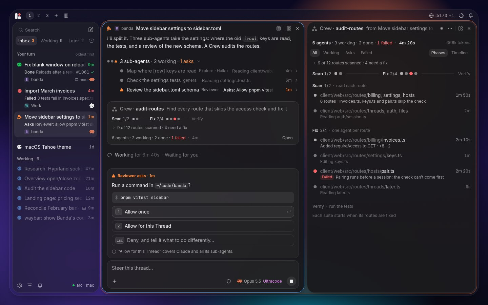
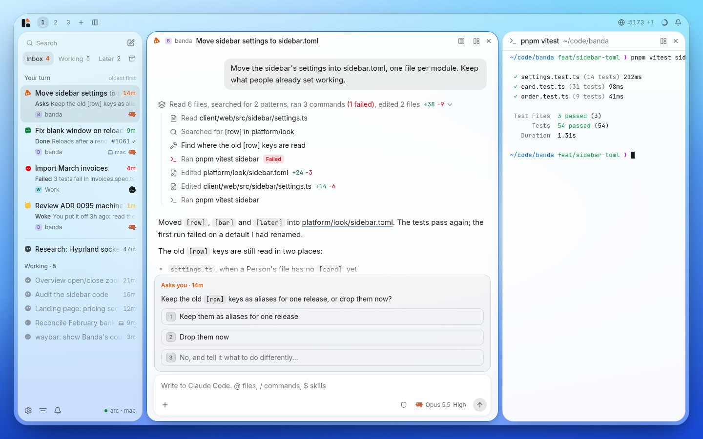
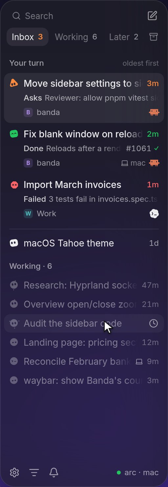
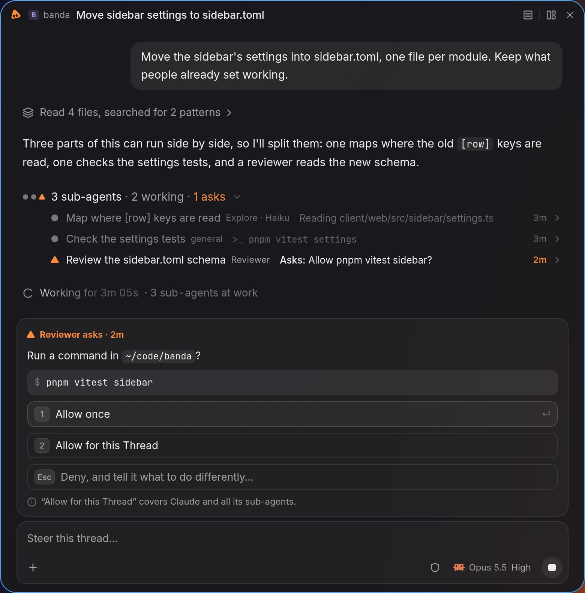
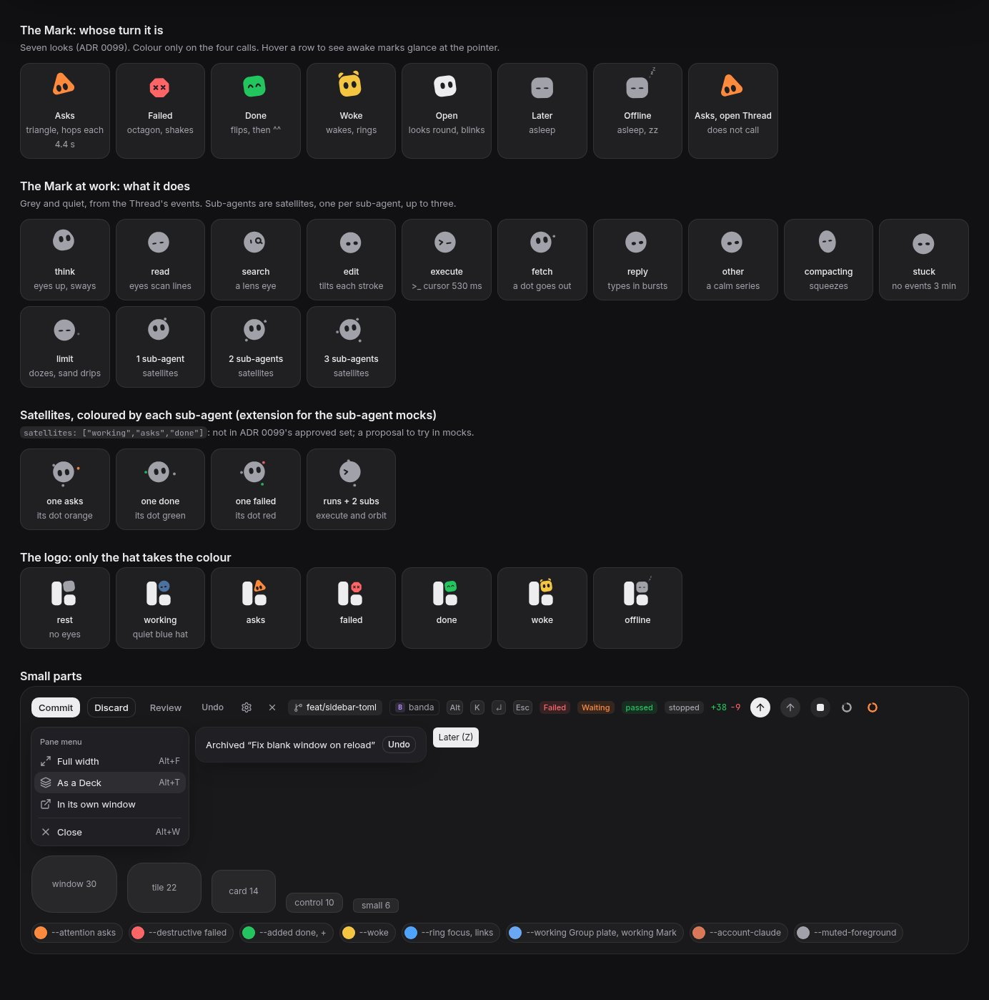
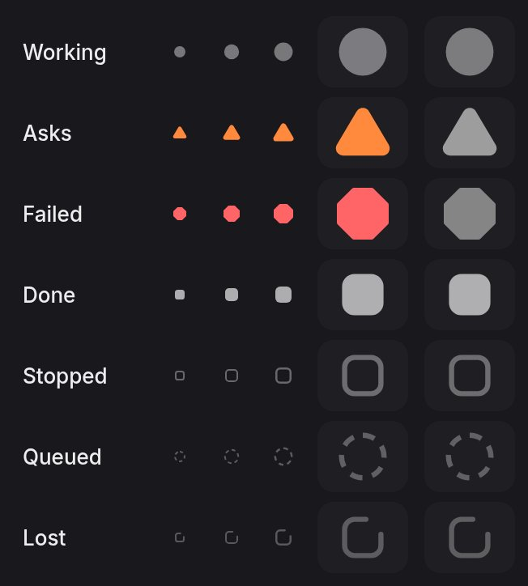
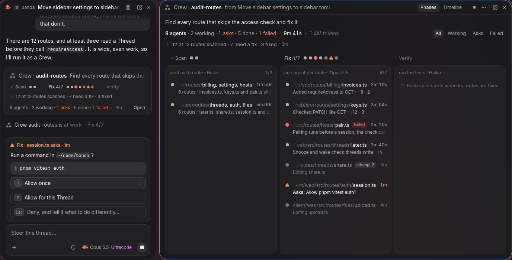

# The Banda look: a design reference

Read this page before you draw anything for Banda: a mock, a Pane, a
widget, a picture for a PR. It says what Banda looks like, with the
numbers, and how to draw a mock of it with the kit in [`kit/`](kit/).

It sums up the ADRs on the look and what the sub-agent mocks of
2026-11-10 added. Roma, that day, on those mocks: the windows and the
look are right; save the style as the reference and follow the mocks'
recommendations. What only the mocks say is marked _(mocks)_: it holds
until an ADR says otherwise, and a change to anything an ADR decided
needs a new ADR first ([`AGENTS.md`](../../AGENTS.md)). The words are
the [GLOSSARY](../../GLOSSARY.md)'s.



- [What makes it Banda](#what-makes-it-banda)
- [Tokens](#tokens): colours, glass, type, icons, radii and spacing,
  elevation, motion
- [Surfaces](#surfaces): the desk and the window, the bar, the Pane
  header, the Group, the sidebar, the Thread, the message box, the Top
  layer
- [The Mark and the satellites](#the-mark-and-the-satellites)
- [Words](#words) · [Scale](#scale-the-surface-grows-with-the-work) ·
  [Do and don't](#do-and-dont)
- [Where the kit and the code differ](#where-the-kit-and-the-code-differ)
- [Make a mock](#make-a-mock) · [Reference shots](#reference-shots)

## What makes it Banda

1. **Quiet.** The screen is mostly text in the text's colour. Nothing
   glows or calls unless it needs the Person, and what moves while an
   Agent works moves slowly. The Thread is "a
   quiet document" ([0058]), the message box "a quiet card" ([0031]),
   the bar "quiet" ([0024]).
2. **Colour only for calls.** Orange asks, red failed, green done,
   yellow woke. In a list the colour is on the mark and the time, never
   the row ([0098] d8). Everything else is the text, muted or faint.
3. **Blue only for focus, selection and links** ([0075] d4). The accent
   is never a state. Main buttons take the text's colour, so the blue
   stays rare. The effort word is lighter text, as [0058] d8 has it and
   the window draws it; only its top level, Ultracode or Ultra, takes
   magenta ([0031] d3).
4. **Working is grey.** An Agent at work needs nothing from the Person,
   so its row is grey and its mark's motion says what it does ([0098]
   d3, [0099] d2). The one working colour is a Group plate's slow blue
   breath ([0065] d6).
5. **Glass over the wallpaper.** The desk is the wallpaper, frosted, under
   a 40% tint; the sidebar's panel is halfway; the tiles are solid; the
   Top layer is solid ([0023], [0036], [0075] d3, [0100] d4: glass is on
   by default).
6. **Large, nested radii.** Five levels, each inner corner its outer one
   less the room between them, so nothing looks pinched ([0080] d6,
   [0100] d3). The kit's numbers are window 30, tile 22, card 14, control
   10, small 6, with 8 px gaps. The window does not draw them yet, and
   they wait for Roma's call on [0100] d11 ([below](#radii-and-spacing)).
7. **One row, no plates.** Pane headers and the bar are one row of text
   and small icons: no pills, no boxed buttons, no line under a Thread's
   header ([0066], [0024] d2, [0031] d8).
8. **Work folds into one line.** "Read 6 files, searched for 2 patterns,
   ran 3 commands (1 failed), edited 2 files +38 −9". It opens to one
   muted line per call ([0058] d4).
9. **Nothing ticks but one clock per surface.** Times are short and
   still: now, 40s, 14m, 2h, 3d ([0098] d8). The Thread's live line is its
   one clock, the Crew Pane's summary its own ([0103] d20).
10. **Fades, not "…".** Long text fades out at its end, and only when it
    does not fit ([0098] d8). A path fades from its start, so the file's
    name stays _(mocks)_.
11. **No emoji, no colour per Agent.** Banda's pictures are lucide icons
    and the Harnesses' Emblems; a Project's Sign may be the Person's
    emoji ([0070]). A sub-agent has its state's colour, never one of its
    own: a Harness's agent `color` is not drawn ([0103] d12).
12. **Shape is state.** Square, all is calm; circle, work goes on;
    triangle, the Person's turn; octagon, it failed. It reads without
    colour ([0099] d1, `client/ui/src/lib/mark-state.ts`).

## Tokens

The names are shadcn's, so a mock maps one to one onto the window. The
values are in [`globals.css`](../../client/ui/src/styles/globals.css) and
the `banda` theme
([`platform/theme/themes/`](../../platform/theme/themes/), [0075] d4);
[`kit/kit.css`](kit/kit.css) has the same, sections 1 to 3.

### Colours

| Token | Dark | Light | For |
|---|---|---|---|
| `--background` | `#19191c` | `#ffffff` | a tile, a Pane's ground |
| `--foreground` | `#ededef` | `#18181b` | text; `--primary` is the same, so main buttons are the text's colour |
| `--muted-foreground` | `#a1a1aa` | `#71717a` | meta, work lines, quiet marks |
| `--muted`, `--accent`, `--secondary` | `#27272a` | `#f4f4f5` | hovers, chips |
| `--card` | `#1f1f23` | `#ffffff` | a card |
| `--popover` (`--floating`) | `#202024` | `#ffffff` | the Top layer: menus, dialogs, toasts |
| `--sidebar` | `#202024` | `#fafafa` | the sidebar's panel |
| desk, solid | `#111113` | `#f4f4f5` | under the tiles with glass off (`desk-solid`) |
| `--border`, `--input` | white 8%, 12% | black 8%, 12% | 1 px lines |
| `--ring`, the accent | `#4ea3ff` | `#0b6fe0` | focus, selection (`#1e3a5f`, `#cfe1fb`), links |
| `--attention` | `#ff8a3d` | `#e5590a` | asks: its mark, its time, "Asks you" |
| `--destructive`, `--removed` | `oklch(0.704 0.191 22.2)` | `oklch(0.577 0.245 27.3)` | failed: its mark, its time, the "Failed" tag; −lines |
| `--added` | `oklch(0.723 0.192 149.6)` | `oklch(0.527 0.137 150.1)` | done; +lines; a PR's ✓ |
| `--woke` (kit) | `#f5c542` | `#f5c542` | woke from Later, plain, no outline ([0099] d1); not a token in the window yet |
| `--working` | `oklch(0.72 0.13 255)` | `oklch(0.6 0.15 255)` | a Group plate at work, and nothing else |
| `--warning` | `oklch(0.8 0.15 80)` | `oklch(0.65 0.16 70)` | a limit that is near ([0024] d2) |
| `--account-claude` | `#d97757` | `#c96442` | Claude's Emblem ([0093]) |
| effort's top level | `#e879f9` | `#c026d3` | the top effort word only, as Ultracode, in the kit ([0031] d3) |

The chat's two fills are mixed from the ground and the ink, so every theme
has them ([0058] d1): a **block** is the text at 3.5% over the
background, **raised** (the Person's bubble, chips, insets) at 7%.

### On glass

Glass is one switch, on by default ([0100] d4). Under it, shadcn's fills,
lines and quiet text become the text's own colour, thinned, so they take
the colour of the glass under them and need no greys of their own
([0036]):

| Token | On glass |
|---|---|
| `--muted`, `--accent`, `--secondary`, `--border` | the text at 10% |
| `--input` | the text at 12% |
| `--muted-foreground` | the text at 62% |
| the desk | `--background` at 40% over the wallpaper, blurred 40 px, saturated 1.4, a grain at 0.04; 10% over the system's material on macOS and Windows ([0030]) |
| the sidebar's panel | halfway between the desk and the tiles, and it frosts what is under it |
| a tile | solid (`[tile] opacity = 1`, [0075] d3); the kit draws 95% ([0023]'s first value) |
| the Top layer | solid, always |

The kit's `.b-window` is glass unless it has `data-glass="off"`; there a
block is the text at 4% and raised at 8%, over the clear tile.

### Type

Inter (variable) for the UI and prose, JetBrains Mono for code, both in
[`kit/fonts/`](kit/fonts/) under the OFL ([0075] d1, [0047]). The
`macos` theme takes the system's font at 13 ([0075] d1). The sizes are
[0058] d1's.

| Role | Size / line | Weight |
|---|---|---|
| prose: replies, the Person's message | 14/22; 15/24 in a Thread 40rem wide or more | 400 |
| UI: rows, work lines, menus | 14/20 | 400; titles 500 |
| meta: times, counts, captions, small buttons | 12/16 | 400; words such as **Asks** 500 |
| mono: code, diffs, commands, paths | 12.5/20 | 400 |
| a reply's headings | 18/26 at most, then 16/24, then the text's | 600 |
| a card's title | 14 | 550 |

Times and counts take tabular figures. Text follows the Pane's width, not
the window's ([0058] d2).

### Icons

[lucide](https://lucide.dev) (client/ui has v1.65), one stroke: 15 px in
rows, 14 in small buttons ([0058] d1), 16 in a Pane header and a menu,
as shadcn draws them (`size-4`).
A call's icon is its kind's: read `file-text`, edit `file-pen`, delete
`trash-2`, move `move-right`, search `search`, execute `terminal`,
think `brain`, fetch `globe`, other `wrench`
(`apps/agents/pane/src/entries/parts/ToolCall.tsx`). A run of work is
`layers`. The Harnesses' Emblems are their own drawings
(`client/ui/src/components/emblem.tsx`).

### Radii and spacing

Five levels ([0080] d6), each inside the one above it:

| Level | Kit | What |
|---|---|---|
| window | 30 | the window, the desk |
| tile | 22 | a Pane's tile, the sidebar's panel (window − the 8 px gap) |
| card | 14 | a card, a Thread's blocks, the bubble, the message box, what docks on it, menus, toasts |
| control | 10 | a button, an input, a row in a list, a menu's item |
| small | 6 | a chip, inline code, a kbd, a tag, a tooltip |
| round | full | the send button, satellites, the Mark's dots |

- ADR 0058 d1 gave the chat its own radii: 6 for chips, 8 for buttons
  and rows, 12 for a block, 16 for the bubble and the message box.
  [0080] d6 puts them on the levels: chips small, buttons control,
  blocks and menus card. The kit draws the bubble and the message box
  at the card's 14 too.
- A Group's plate is the tile's radius plus its margin, half a gap
  ([0065] d6).
- **Spacing**: 8 px between tiles and round the Strip (`[gaps]`), 8 inside
  a panel, a 4 px grid inside everything, 20 between a Thread's rows, 8 to
  12 inside them ([0058] d1).
- **Heights**: the bar 36 (macOS 38), a Pane header 40 in the kit, a
  control 28, an icon button 28 or 24 in a header, a menu's item 30, a
  sidebar row about 28, a card three lines.
- **The window draws these levels** ([0100] step 3): tokens
  `--window-radius` … `--small-radius`, classes `rounded-window` …
  `rounded-small`, and a test refuses any other corner. A theme says
  `window` and `control` in `[shape]`; the tile is the window less the
  outer gap, the card the tile less 8, the small 0.6 of a control.
  Omarchy takes Hyprland's rounding for the window's corner and a third
  of it for a control's, so Hyprland square is Banda square ([0100] d11,
  way A). shadcn's ladder lands on them: `sm` small, `md` and `lg`
  control, `xl` and up card.

### Elevation

None, mostly: a thing stands apart by a 1 px line (`--border`, inset) and
a step of fill (block 3.5%, raised 7%), not by a shadow. Shadows are only
for what floats: the window over the desktop, the glass sidebar's panel
(`sidebar-shadow` 0.45), the focused tile's soft lift ([0075] d5), the
light message box's hairline and haze, copied from Codex ([0031] d1), and
the Top layer. There is no shadow under the current card ([0098] d8), no
glow and no coloured ring.

### Motion and rhythm

The Mark is the one thing that moves on its own, and its motion means
something ([0099] d4):

| What | Time |
|---|---|
| a call: asks hops, failed shakes | once every 4.4 s |
| a blink | every 3.7 s |
| a breath; sleep | 2.6 s; 4.2 s |
| a change of look blends | 0.45 s |
| a change of shape leaps | 0.6 s |
| an event shows at least | 1.5 s, so fast tools do not flicker |
| `>_` cursor | 530 ms |
| a Group plate at work breathes; a change of state crossfades | 3.2 s; 0.6 s ([0065] d6) |
| hovers, opening a line | 120 to 200 ms, eased (kit `--dur-fast`, `--dur`) |
| the tiling | niri's springs, `[motion]` in `look.toml` |

- **A first draw has no news.** A mark, a plate or a satellite drawn for
  the first time starts in its state, as if it had always been there;
  only a real change animates ([0099] d4, [0065] d6).
- **The open Thread's mark does not call** ([0099] d5). Awake marks glance
  at the pointer over their row (d6).
- **Quiet** stills every call, and the shapes and colours stay ([0098]
  d21, [0099] d7).
- **Reduced motion and `[motion] off`** draw the still poses: every look
  has one (d8), and the colours and the ladder stay.
- **Satellites never move on their own**; a change blends in 0.45 s, or
  leaps in 0.6 s to a new shape ([0103] d12).

## Surfaces

### The desk and the window



- In a mock the window is a rounded screen (30) with a 1 px light line, a
  highlight on its top edge and a soft drop shadow, over a wallpaper.
- The desk inside it is the wallpaper, blurred and tinted (above); with
  glass off it is `desk-solid`. Under the bar: the sidebar's panel, then
  the Strip's columns, 8 px apart and 8 px from the edges.
- On Linux Banda draws the glass from the wallpaper; on macOS and Windows
  the system does ([0030]).

### The bar

One row, 36 px, text at the meta size in muted ([0024], [0098] d20–22):

- **Left**: the Mark as the logo (it opens the sidebar and the Banda
  menu), the workspaces' numbers `1 2 3` and `+`, the current one on a
  faint fill, then the Flow's icon (`columns-3`, [0098] d20). In the
  row and solo, a Project's workspace shows by its Sign alone ([0102]).
- **Middle**: empty but for the sidebar's counts while the sidebar is
  hidden ([0035]). [0098] d22 puts them beside the logo, which shows the
  loudest state: Your turn in its colour, the working in grey, "3 · 7",
  nothing when nothing calls.
- **Right**: widgets that show only with something to say: ports
  `:5173 +1`, the limits' ring ([0043]), an update, the bell ([0048]).
- No boxes, no pills, no call dots on the numbers ([0102]); only the
  widget under the pointer gets a fill.

### Tiles and the Pane header

- A tile: the tile radius, the tile's ground, a 1 px line in `--border`.
  **The focused tile** is one pixel of the accent and a soft shadow, not
  a thick frame ([0075] d5).
- **The header is one row** ([0066]), left to right: the Pane's icon or
  the mark of what it shows; the Project's Sign and name, quiet (before
  a Thread's title; after another Pane's while its workspace mixes
  Projects, d7); the **title** at 500; the detail in muted (a terminal
  says its program and folder: "pnpm vitest ~/code/banda"); the App's
  own words; then **the capsule**.
- **The capsule** is the buttons at the header's end: the App's icon
  buttons, a thin line (1 × 14, the text at 10%), the Pane menu
  (`layout-panel-left`) and close (`x`). No plate (amended 2026-11-05).
  Faint until the Pane has the focus or the pointer; nothing in it moves.
- **A Thread's header is bare**: no line under it; its mark (it does not
  call), its Project, its title ([0031] d8).
- A double click makes the column the screen's width, a middle click
  closes the Pane, a right click opens the Pane menu ([0066] d4). On a
  Thread's title a click opens the Thread menu, and a double click
  renames it ([0077]).

### The Group plate

An Agent's Panes are its Group, one plate behind their columns ([0065]
d6–7):

- The plate stands half a gap out, its radius the tile's plus that.
- Its colour is the Agent's state, on a ladder from quiet to loud, fill
  and line: none 4% and 9%, working 7% and 18%, done 10% and 30%, failed
  10% and 36%, asking 13% and 48%; the focused Group adds 2% and 18%.
- Working breathes; a call swells twice, then stays; done and failed swell
  once as they come. On glass the plate is a step clearer than the tiles,
  with a light top edge. No label, no shadow.

### The sidebar



The Person's inbox ([0098]), 16rem wide, a glass panel with the tile's
radius:

- **Header**: Search, quiet, with no frame (its key on hover), and ✎ (a
  new Thread). Under it the tabs **Inbox · Working · Later** and Archive
  as an icon. A tab's count is plain; Inbox's is orange while something is
  the Person's turn.
- **Inbox** has three parts: **Your turn**, cards, oldest first; **Open**,
  one line each in the normal colour, under a divider; **Working**, a grey
  shelf of one-line rows, the first six, then "+ N more".
- **A card is three lines, each with a left and a right**:

  | | Left | Right |
  |---|---|---|
  | 1 | the mark, the title | the time, in the call's colour |
  | 2 | a word, **Asks**, **Done**, **Failed** or **Woke**, then what it says | a PR's ✓ or ✗, or the diff in grey |
  | 3 | the Project's Sign and name | the machine, the account's Emblem |

  Lines 2 and 3 are at the meta size, 22 px in from the mark. Padding 6 ×
  8, the control's radius, 2 px between lines.
- **A working row** is one line: a grey mark that moves by what its Agent
  does, the title at 45% of the text, the time. Its words, on a card or on
  hover, say what it does now: "pnpm test", "Edits Row.tsx", "3 sub-agents
  at work", "No events for 6m", "Usage limit · goes on at 15:00".
- **The current card** has a fill of the text at 8%: no shadow, no
  accent border. A hover is 5%. No card grows on hover or click.
- **Hover actions** take the time's place, as icons: Later (`clock`),
  Archive (`check`), Wake (`undo-2`), Unarchive (`archive-restore`).
- **The foot**: Settings, View and Quiet as icons; on the right the
  machines, "● arc · mac".
- A Harness's sub-agents have no cards: they are satellites on their
  Agent's mark, and line 2 counts them (d23). A Thread another Agent
  started through Banda is a child: under its parent in Working, with ↳
  (d24).

### The Thread



A quiet document ([0058]):

- **The column** is at most 768 px, centred, 16 px from the sides (24 from
  40rem); rows 20 px apart. The messages fade out under the header and
  over the message box, a plain mask ([0031] d7).
- **The Person's message** is a bubble on the right: at most 80% wide, the
  raised fill, the card radius, padding 8 × 14, no avatar. A queued one is
  dashed.
- **The Agent's words** are prose: no bubble, no avatar. Inline code is a
  mono chip on the raised fill. **A path is a link** to its file, when
  the file exists: in plain text only underlined; as inline code, its
  chip with a file icon, the folder dimmed, the name bright and a thin
  line under it ([0063] d2). A Markdown link takes the accent ([0075]
  d4).
- **The work line** is one muted 14/20 row: its icon at 15 px, the verb in
  the past tense and muted, the subject (a file, a command) in the text's
  colour, the counts, a chevron. Opened, one muted line per call under one
  rule. What failed is a small red "Failed" tag, never a red row; a call
  that runs shimmers.
- **A sub-agent** is one row at the place it started: its satellite (10),
  its title, its role in muted, what it does now in grey, fading, its
  time, a chevron. Two to six started by one message are one **group
  row**, "3 sub-agents · 2 working · 1 asks", the members under it; once
  settled it dims, "Ran 3 sub-agents · 2m 40s". A row opens in place: the
  brief, its work as one work line, its report ([0103] d15).
- **A Crew** puts one card in the Thread: its glyph, "Crew ·
  audit-routes" and what it does, the strip of its phases, one narrator
  line, the counts ("12 agents · 6 working · 4 done · 2 failed", only the
  asks and the failed in colour) and **Open** ([0103] d18).
- **The changes card** is a block: "Edited 2 files +38 −9" and
  **Review**, then a row per file, its folder muted, its name in the
  text's colour, + and − in green and red ([0058] d7).
- **A block** (code, a table, a diagram, a card, a console) is one shape:
  the block fill, a 1 px line, the card radius, a label top left, actions
  top right, faint until hovered ([0058] d3).
- **The live line** sits at the live edge while a turn runs: a spinner and
  "Working for 45s · Running pnpm test · 11s", or "· Waiting for you", or
  "· 3 sub-agents at work" ([0103] d19). It is the Thread's one clock, and
  with the Thread's mark the only place that says the Agent works
  ([0058] d5, [0031] d5).
- A Thread opens where what the Person has not seen begins, and follows
  only while the Person watches ([0094]).

### The message box and what docks on it

The message box is the Person's place at a Thread's foot (ADR 0031 calls
it the composer):

- **A quiet card**, as wide as the messages, centred, with no focus
  ring: in dark a step lighter than the tile, with a hairline; in light
  the tile's white with Codex's soft shadow ([0031] d1). The kit draws the
  block fill and a 1 px line that goes to the text at 15% on focus.
- **Its words** name the Harness that is there: "Write to Claude Code. @
  files, / commands, $ skills"; while a turn runs, "Steer this thread…"
  (`apps/agents/pane/src/composer/placeholder.ts`).
- **Its row**: `+` on the left; on the right the shield (the mode) and the
  model picker (the account's Emblem, the model, then the effort: lighter
  text in the window, blue in the kit, its top level magenta: "Opus 5.5
  Ultracode"), then the round send button
  (the text's colour; the text at 10% while empty). **Stop** is round and
  neutral with a rounded square inside, never red. Controls are 28 px
  ([0031] d2–3, [0058] d8).
- **It never says the Agent works**, and there is no Plan button (`/plan`
  is) ([0031] d4–5).
- **Decisions dock on it** ([0058] d6), in a block of the same shape just
  above it: the head at the meta size, 600, in orange ("Asks you · 14m",
  or "**Reviewer** asks · 2m" with an orange triangle when a sub-agent
  asks, [0103] d28); the question; a command in mono on the raised fill; the
  choices as rows with their keys, `1`–`9`, `⏎` on the main one, `Esc` on
  "Deny, and tell it what to do differently…"; a quiet note under them
  when an answer reaches further ("“Allow for this Thread” covers Claude
  and all its sub-agents").
- **An opened sub-agent** has no message box: a status bar takes its place,
  the same shape: its satellite (12), "Working · reviewer · Runs on its
  own", then **Ask Claude about it** and Stop ([0103] d21).

### The Top layer: menus, dialogs, toasts

- **Solid** over glass, always (`--floating`, [0075] d3).
- **A menu**: the card radius, 4 px inside, items 30 px high at the
  control's radius, a 16 px icon in muted, the key on the right in muted,
  a label at 11 px, separators as 1 px lines. The Pane menu shows each
  row's key ([0066] d3).
- **A toast** is Sonner's, at the window's top right: one line and one
  action: "Archived · Undo" ([0048], [0098] d10).
- **A tooltip** is the text's colour as its ground, the meta size, the
  small radius, with its key: "Later (Z)".

## The Mark and the satellites



### The Mark

Banda's sign: three tiles, the top one an Agent with eyes (GLOSSARY,
Mark). It is drawn by [`kit/mark.js`](kit/mark.js) in mocks; ADR 0099's
looks are not in the window yet (`client/ui/src/lib/mark-state.ts` has the
eight states before it).

| Look | Shape | Colour | Motion |
|---|---|---|---|
| Asks | triangle | `--attention` | hops every 4.4 s |
| Failed | octagon, a stop sign | `--destructive` | × eyes, shakes every 4.4 s |
| Done | square | `--added` | flips once, then ^^ eyes |
| Woke | square | `--woke` | wakes, rings two small bells |
| Open | square | the text's (light: 80%) | looks around, blinks |
| Later | square | muted | asleep, breathes, no zz |
| Offline | square | muted | asleep with zz |

- **At work** it is grey (dark: the text at 30%; light: `#71717a` at 70%,
  [0099] d10) and shows what its Thread does: think (eyes up, a sway),
  read (eyes scan), search (a lens), edit (tilts with each stroke),
  execute (`>_`), fetch (a dot goes out), reply (types), other (a calm
  series), **sub-agents (satellites, one each, up to three)**, compacting
  (squeezes), stuck (no event for 3 minutes, half-closed eyes), a usage
  limit (dozes, sand drips).
- **The logo** in the bar shows the loudest of every Thread: offline ›
  failed › asking › woke › done › working › rest. Only its hat, the
  Agent's tile, takes the colour and the motion; the two tiles under it
  stay the text's ([0099] d9).
- **Satellites on the Mark** stay grey, as ADR 0099 has them; only a
  failed sub-agent's takes colour: a red octagon at 48 px, a red 3 px dot
  at 16 px, while its Thread works ([0103] d13). No orange satellite: a
  sub-agent that asks makes the Thread itself ask. The kit takes
  `satellites: ["working", "failed"]`.

### Satellites: shape is state



A sub-agent is a satellite everywhere: on its Agent's mark, at the start
of its row in the Thread, as a dot in a Crew's strip, as the icon of a
sub-agent opened in a Pane. It is the Mark's grammar without eyes and
without motion of its own ([0099] d3: a sub-agent has no mark; [0103] d12):

| State | Shape | Colour |
|---|---|---|
| Working | a filled circle | the text at 45% |
| Asks | a rounded triangle | `--attention` |
| Failed | an octagon | `--destructive` |
| Done | a rounded square | the text at 70%: calm, not green |
| Stopped | a square's outline | the text at 38% |
| Queued | a dashed circle | the text at 32% (Crews only) |
| Lost | a faint square's outline with a gap | the text at 30% |

- **Sizes**: 8 in a Crew's strip, 10 at the start of a row (in a 16 px
  slot), 12 in a Pane header and the status bar.
- **Only asks and failed take colour.** A sub-agent that fails stays in
  its Thread: the parent's card does not move. One that asks makes the
  Thread ask: its card goes to Your turn, line 2 "Asks · Reviewer: allow
  pnpm test?".
- The kit draws them: [`kit/sub.js`](kit/sub.js), [`kit/SUB.md`](kit/SUB.md).



## Words

- **English in the UI**, in short plain words, and the GLOSSARY's terms
  exactly: Person, Agent, Thread, Pane, Project, Harness, Group,
  workspace, Later, Sub-agent, Crew. "Workflow" and "Task" are taken:
  the sub-agents one Thread sets to work in phases are a **Crew**
  ([0103] d2).
- **Name the Harness that is there**: "Write to Claude Code", "Ask Claude
  about it", "Codex". Never "Claude" for every Agent.
- **Times are short and still**: now, 40s, 14m, 2h, 3d. A duration, "1m
  12s", only once a run has ended.
- **State words** are Banda's: Working, Asks, Done, Failed, Stopped,
  Queued (waiting for a slot), Lost (stopped when Banda restarted), Woke.
- **Actions say what they do**: Review, Open beside, Ask Claude about it,
  Ask Claude to go on, Allow once, Deny, and tell it what to do
  differently…. Icons stand alone where a tooltip names them and their
  key.
- **Counts read as a sentence**: "3 sub-agents · 2 working · 1 asks",
  "12 agents · 3 phases · 2 failed".
- **Russian only in a mock's notes for Roma**, never in the UI.

## Scale: the surface grows with the work

Draw the smallest thing that holds the work, and grow it only as the work
grows ([0103] d14):

| How much | In the Thread | Beside it | The sidebar | The Mark |
|---|---|---|---|---|
| one sub-agent | one **row** | opened beside on demand | line 2: "Explore at work" | 1 satellite |
| 2 to 6 from one message | one **group row**, members under it | the same | "3 sub-agents at work" | up to 3 |
| a Crew, any size | one **card** | the Crew **Pane**, in the Thread's Group | "Crew audit-routes · Fix 4/7" | 3, and the count in words |

Never a wall of nested logs in the parent, a card per sub-agent in the
sidebar, or a parent that looks done while its sub-agents work.

## Do and don't

**Do**

- Keep every row grey until the Person must act; then colour the mark and
  the time, and nothing else.
- Keep headers one row: icon or mark, Project, title, muted detail, the
  capsule with no plate.
- Fold work, a sub-agent's too, into one line that opens to muted rows.
- Dock every question, an Agent's or a sub-agent's, on the message box,
  with its keys.
- Use the radius ladder, nested, and the 8 px gap.
- Use lucide at 15 and 14 px, and the real Emblems.
- Draw only what the engine can know: `doing`, `stepped`, `subagents`,
  `compacting`, `limit_until` ([0099] d11).
- Try both themes, and glass on and off.

**Don't**

- Colour working: no blue rows, no progress bars in a list.
- Put pills, boxes, badges or call dots in the bar or a header.
- Grow a card on hover, add a shadow or an accent border to the current
  one, or bring back "↑ N updates".
- Use red for a whole row or for Stop.
- Say in the message box that the Agent works, or crowd its row.
- Tick a time anywhere but the surface's one clock, or animate a
  background.
- Show thinking in a scrolling box, or a tool's output in a big panel
  inline.
- Truncate with "…"; fade.
- Draw menus, dialogs or toasts on glass.
- Give an Agent or a sub-agent a colour of its own.

## Where the kit and the code differ

The kit draws where the ADRs go; the window is on its way there.

| What | The kit | The window today |
|---|---|---|
| a tile over glass | 95% | solid ([0075] d3) |
| the Pane header | 40 px | 36 px (`pane-header.tsx`) |
| the Mark | ADR 0099's seven looks, doings, satellites | the eight states before ADR 0099 |
| `--woke` | `#f5c542` | not a token yet |
| the effort's top level | magenta, `--effort-top` ([0031] d3) | not drawn: no token holds it |
| satellites, Crews, the status bar | drawn | not built: the mocks of 2026-11-10 |

A mock follows the kit. A change to the window follows the ADRs, and says
in its PR which of these it closes.

## Make a mock

A change Roma will see is shown as a mock before it is built
([`AGENTS.md`](../../AGENTS.md#show-it-first)).

### The kit

| File | What it gives |
|---|---|
| [`kit.css`](kit/kit.css) | the tokens, dark by default and light under `data-theme="light"`, the glass, and a class for every part: `b-` classes |
| [`icons.js`](kit/icons.js) | 86 lucide icons and the two Emblems, inline: `<i data-icon="search" data-size="15">`, `<i data-emblem="claude">`, `BandaIcons.svg(name, size)` |
| [`mark.js`](kit/mark.js) | the Mark: `<span data-mark="working" data-doing="execute" data-satellites="2">`, `data-logo`, `data-calls="false"`, `data-size`; `BandaMark.mount(el, {state, doing, satellites, size, news})` gives `set()` and `destroy()`; `BandaMark.quiet = true` |
| [`sub.css`](kit/sub.css), [`sub.js`](kit/sub.js) | satellites, sub-agent rows, group rows, Crew strips and cards, the status bar: `<span data-sat="asks">`, `Sub.row()`, `Sub.group()`, `Sub.strip()`, `Sub.crew()`; [`SUB.md`](kit/SUB.md) has it all |
| [`demo.html`](kit/demo.html) | a whole window, then the sheet: every look of the Mark, the small parts, the ladder, the colours. Copy markup from it |
| [`sub-demo.html`](kit/sub-demo.html) | every sub-agent part, in context, its notes in Russian |
| [`shot.mjs`](kit/shot.mjs) | the pictures: below |
| [`fonts/`](kit/fonts/) | Inter and JetBrains Mono, with their OFL texts |

The skeleton, with the kit beside the page:

```html
<link rel="stylesheet" href="kit/kit.css" />
<body class="b-kit">
  <div class="b-screen">
    <div class="b-window">
      <!-- data-glass="off" here; data-theme="light" on <html> -->
      <header class="b-bar">…</header>
      <div class="b-body">
        <aside class="b-sidebar">…</aside>
        <div class="b-strip">
          <section class="b-tile is-focused">
            <div class="b-pane-head b-bare">
              <span data-mark="asks" data-calls="false"></span>
              <span class="b-pane-title">…</span>
              <div class="b-capsule">…</div>
            </div>
            <div class="b-thread"><div class="b-chat">…</div></div>
          </section>
        </div>
      </div>
    </div>
  </div>
  <script src="kit/icons.js"></script>
  <script src="kit/mark.js"></script>
</body>
```

Markup written from a script after load needs
`BandaIcons.scan(); BandaMark.scan(); Sub.scan()`. A page published
elsewhere, as a claude.ai Artifact, takes the fonts along or loads them
from Google Fonts.

### A mock page

- **One scenario** on every page of a topic, with the same Project,
  Thread, names and times, so pages compare.
- **The UI in English; the notes for Roma in Russian**: each section's
  title, what it shows, the questions.
- **One section per variant**, `<section id="a">`, `id="b"`…, so a picture
  takes one section (`--selector "#a"`) and Roma can answer "B".
- **Variants and one pick**: mark the one you recommend **«Мой выбор»**,
  with one line of why. End with the questions, each with your pick.
- **The hash words** `#light` and `#solid` switch the theme and the glass;
  the kit's demos also take the `t` and `g` keys.
- **Only what is real**: no control the Harness or the engine cannot
  back. Say "later" in a note for what needs new engine work.

### Check it

```sh
node docs/design/kit/shot.mjs PAGE.html out.png                  # 1440 × 900, dark glass
node docs/design/kit/shot.mjs PAGE.html out.png --width 728 --full
node docs/design/kit/shot.mjs PAGE.html out.png --light
node docs/design/kit/shot.mjs PAGE.html out.png --solid
node docs/design/kit/shot.mjs PAGE.html a.jpg --selector "#a" --type jpeg --quality 85
```

- It needs `pnpm install` in this checkout, for playwright-core, and a
  Chromium: the system's, one named with `--chromium`, or Playwright's.
- It prints the page's errors, the console's errors and what did not
  load, and then exits 1: a mock is done with none.
- **Look at every picture** you take, at 1440 and at 728, in light and
  with the glass off: a fade that cuts a word, a line that wraps, a
  colour where nothing calls.
- **Then look with fresh eyes**: a second Agent, or you again with only
  the brief, goes through the pictures against this page's rules and
  lists what is off. Fix it, take the pictures again, and only then show
  Roma.

## Reference shots

Taken with `kit/shot.mjs` from the sub-agent mocks of 2026-11-10, which
are in the brand workspace's `artifacts/subagents/mocks/`, and from the
kit's own demos. Each is a JPEG at quality 85.

| Shot | What | Taken from |
|---|---|---|
| [`window.jpg`](shots/window.jpg) | the whole window mid-run, dark glass | `00-hero.html --selector "#stage"` |
| [`thread.jpg`](shots/thread.jpg) | a Thread with sub-agents, one asking | `01-thread.html --selector "#a .pg-a > section.b-tile" --scale 2` |
| [`sidebar.jpg`](shots/sidebar.jpg) | the sidebar's Inbox | `05-sidebar.html --selector "#winA .b-sidebar" --scale 2` |
| [`crew-pane.jpg`](shots/crew-pane.jpg) | the Crew Pane beside its Thread | `03-crew-pane.html --selector "#a .pg-stage"` |
| [`satellites.jpg`](shots/satellites.jpg) | the satellite grammar | `kit/sub-demo.html --selector "#sats" --clip=-14,22,326,362 --scale 2` |
| [`kit-sheet.jpg`](shots/kit-sheet.jpg) | the kit's sheet | `kit/demo.html --selector ".sheet"` |
| [`light.jpg`](shots/light.jpg) | the kit's window, light | `kit/demo.html --light` |

[0023]: ../adr/0023-a-glass-desk-that-banda-draws-and-tiles-that-float-over-it.md
[0024]: ../adr/0024-the-bar-is-quiet-and-modules-put-widgets-on-its-right.md
[0030]: ../adr/0030-the-glass-is-the-systems-on-macos-and-windows-and-banda-draws-it-on-linux.md
[0031]: ../adr/0031-the-composer-is-a-quiet-card-as-in-t3-code.md
[0035]: ../adr/0035-the-bar-s-middle-counts-who-waits-and-who-works.md
[0036]: ../adr/0036-shadcn-on-glass-is-the-texts-own-colour-thinned.md
[0043]: ../adr/0043-the-bar-shows-how-much-of-the-limits-is-spent-and-a-pane-counts-the-usage.md
[0047]: ../adr/0047-the-terminal-has-its-own-file-and-writes-in-jetbrains-mono-off-linux.md
[0048]: ../adr/0048-the-toasts-are-sonner-s-and-a-bell-shows-the-last-ones-again.md
[0058]: ../adr/0058-the-thread-reads-as-a-quiet-document.md
[0063]: ../adr/0063-paths-notes-and-a-right-click-work-in-the-thread.md
[0065]: ../adr/0065-columns-group-the-deck-moves-to-alt-t-and-an-agents-panes-are-its-group.md
[0066]: ../adr/0066-the-pane-header-is-banda-s-with-a-capsule-and-the-pane-menu.md
[0070]: ../adr/0070-a-project-has-a-sign-found-in-its-folder-or-picked-by-hand.md
[0075]: ../adr/0075-three-themes-macos-omarchy-and-banda-each-bring-their-shape.md
[0077]: ../adr/0077-the-person-names-a-thread-and-its-harness-s-small-model-suggests-the-name.md
[0080]: ../adr/0080-a-theme-extends-another-and-says-little-and-every-client-draws-the-same-tokens.md
[0093]: ../adr/0093-an-account-has-an-emblem-the-person-picks-and-a-new-thread-has-a-fallback-account.md
[0094]: ../adr/0094-a-thread-opens-where-what-the-person-has-not-seen-begins.md
[0098]: ../adr/0098-the-sidebar-is-the-persons-inbox-of-their-agents-work.md
[0099]: ../adr/0099-the-mark-says-whose-turn-it-is-and-what-the-agent-does.md
[0100]: ../adr/0100-the-look-splits-in-three-and-each-platform-has-a-banda-theme-that-follows-it.md
[0102]: ../adr/0102-in-the-row-and-solo-a-project-has-its-own-workspace-and-free-workspaces-hold-the-rest.md
[0103]: ../adr/0103-a-harness-s-sub-agents-work-in-their-thread-and-a-crew-shows-beside-it.md
